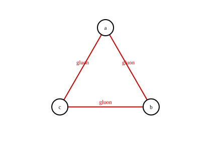
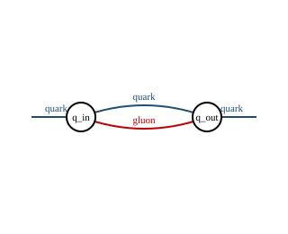
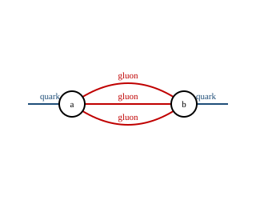
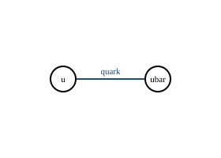

# Feynman diagrams

`myqcd.feynman` stores diagrams as vertices and edges;
`myqcd.diagram_export` writes TikZ-Feynman, Graphviz DOT and SVG. The exporter
places tree diagrams on a horizontal chain, pure cycles on a circle, and
parallel edges on separated quadratic curves.

## Two-point chain


$V = 3$, $E_{\mathrm{int}} = 2$, $C = 1$, and
$L = E_{\mathrm{int}} - V + C = 0$.

## Three-gluon triangle



$V = 3$, $E_{\mathrm{int}} = 3$, $C = 1$, and
$L = E_{\mathrm{int}} - V + C = 1$.

## Quark self-energy (one loop)



$V = 2$, $E_{\mathrm{int}} = 2$ (one quark and one gluon line), $C = 1$, and
$L = E_{\mathrm{int}} - V + C = 1$. The two external quark legs are drawn as
stubs and do not enter $E_{\mathrm{int}}$.

## Sunset (two loops)



$V = 2$, $E_{\mathrm{int}} = 3$ (three internal gluons), $C = 1$, and
$L = E_{\mathrm{int}} - V + C = 2$.

## Wick pairing



$V = 2$, $E_{\mathrm{int}} = 1$, $C = 1$, and
$L = E_{\mathrm{int}} - V + C = 0$.

## Loop-count comparison

| Diagram | $V$ | $E_{\mathrm{int}}$ | $C$ | $L$ | Standard |
|---|---|---|---|---|---|
| two-point chain | 3 | 2 | 1 | 0 | tree |
| three-gluon triangle | 3 | 3 | 1 | 1 | one loop |
| quark self-energy | 2 | 2 | 1 | 1 | one loop |
| sunset | 2 | 3 | 1 | 2 | two loops |
| Wick pairing | 2 | 1 | 1 | 0 | tree |

External-leg edges (endpoint $-1$) are excluded from $E_{\mathrm{int}}$; this
is why a two-vertex diagram with one internal and one external edge still has
$L = 0$.

## QCD rule catalog

| Vertex | Particles | Color factor | Lorentz factor | Coupling power |
|---|---|---|---|---|
| quark-antiquark-gluon | $q,\bar q,g$ | $T^a_{ij}$ | $\gamma_\mu$ | $g$ |
| three-gluon | $g,g,g$ | $f^{abc}$ | $(k_1-k_2)_\rho\delta_{\mu\nu}+\cdots$ | $g$ |
| four-gluon | $g,g,g,g$ | $f^{abe}f^{cde}$ | $\delta_{\mu\nu}\delta_{\rho\sigma}$ permutations | $g^2$ |
| ghost-antighost-gluon | $c,\bar c,g$ | $f^{abc}$ | $k_\mu$ | $g$ |

## Export

```python
from myqcd import diagram_export, feynman

triangle = feynman.Diagram(
    vertices=("a", "b", "c"),
    edges=(
        feynman.Edge(0, 1, "gluon"),
        feynman.Edge(1, 2, "gluon"),
        feynman.Edge(2, 0, "gluon"),
    ),
)
assert triangle.loop_count == 1
print(diagram_export.to_tikz(triangle))
print(diagram_export.to_dot(triangle))
print(diagram_export.to_svg(triangle)[:60])
```

## Command

```bash
python -m myqcd.operator_audit
```
