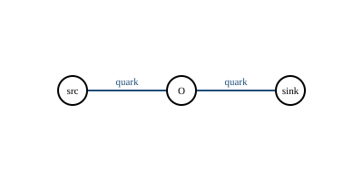

# Feynman diagrams

`myqcd.feynman` stores diagrams as vertices and edges;
`myqcd.diagram_export` writes TikZ-Feynman, Graphviz DOT and SVG.

## Two-point chain



`V = 3`, internal edges `E_int = 2`, `C = 1`, loop number
`L = E_int - V + C = 0`.

## Three-gluon triangle


`V = 3`, internal edges `E_int = 3`, `C = 1`, loop number
`L = E_int - V + C = 1`.

## Wick pairing


`V = 2`, internal edges `E_int = 1`, `C = 1`, loop number
`L = E_int - V + C = 0`.

## Loop-count comparison

| Diagram | V | E_int | C | L | Standard |
|---|---|---|---|---|---|
| two-point chain | 3 | 2 | 1 | 0 | tree |
| three-gluon triangle | 3 | 3 | 1 | 1 | one loop |
| Wick pairing | 2 | 1 | 1 | 0 | tree |

External-leg edges (endpoint `-1`) are not counted in `E_int`; this is why a
two-vertex diagram with one internal and one external edge still has `L = 0`.

## QCD rule catalog

| Vertex | Particles | Color factor | Lorentz factor | Coupling power |
|---|---|---|---|---|
| quark-antiquark-gluon | q, qbar, g | `T^a_ij` | `gamma_mu` | 1 |
| three-gluon | g, g, g | `f^abc` | `(k1-k2)_rho delta_mu_nu + ...` | 1 |
| four-gluon | g, g, g, g | `f^abe f^cde` | `delta_mu_nu delta_rho_sigma permutations` | 2 |
| ghost-antighost-gluon | c, cbar, g | `f^abc` | `k_mu` | 1 |

## Export

```python
from myqcd import diagram_export, feynman

triangle = feynman.Diagram(
    vertices=("a", "b", "c"),
    edges=(
        feynman.Edge(0, 1, "gluon"),
        feynman.Edge(1, 2, "gluon"),
        feynman.Edge(2, 0, "gluon"),
    ),
)
assert triangle.loop_count == 1
print(diagram_export.to_tikz(triangle))
print(diagram_export.to_dot(triangle))
print(diagram_export.to_svg(triangle)[:60])
```

## Command

```bash
python -m myqcd.operator_audit
```
