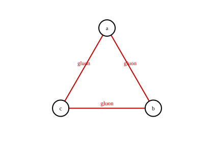
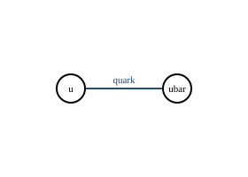

# 费曼图

`myqcd.feynman` 用顶点与边存储费曼图；`myqcd.diagram_export` 导出
TikZ-Feynman、Graphviz DOT 与 SVG。

## 两点链图


`V = 3`，内部边 `E_int = 2`，`C = 1`，圈数
`L = E_int - V + C = 0`。

## 三胶子三角图



`V = 3`，内部边 `E_int = 3`，`C = 1`，圈数
`L = E_int - V + C = 1`。

## Wick 配对图



`V = 2`，内部边 `E_int = 1`，`C = 1`，圈数
`L = E_int - V + C = 0`。

## 圈数对照

| 图 | V | E_int | C | L | 标准 |
|---|---|---|---|---|---|
| 两点链图 | 3 | 2 | 1 | 0 | 树图 |
| 三胶子三角图 | 3 | 3 | 1 | 1 | 单圈 |
| Wick 配对图 | 2 | 1 | 1 | 0 | 树图 |

外部腿边（端点为 `-1`）不计入 `E_int`；因此“两顶点、一条内部边加一条外部
腿边”的图仍然满足 `L = 0`。

## QCD 规则清单

| 顶点 | 粒子 | 颜色因子 | Lorentz 因子 | 耦合幂次 |
|---|---|---|---|---|
| quark-antiquark-gluon | q, qbar, g | `T^a_ij` | `gamma_mu` | 1 |
| three-gluon | g, g, g | `f^abc` | `(k1-k2)_rho delta_mu_nu + ...` | 1 |
| four-gluon | g, g, g, g | `f^abe f^cde` | `delta_mu_nu delta_rho_sigma permutations` | 2 |
| ghost-antighost-gluon | c, cbar, g | `f^abc` | `k_mu` | 1 |

## 导出

```python
from myqcd import diagram_export, feynman

triangle = feynman.Diagram(
    vertices=("a", "b", "c"),
    edges=(
        feynman.Edge(0, 1, "gluon"),
        feynman.Edge(1, 2, "gluon"),
        feynman.Edge(2, 0, "gluon"),
    ),
)
assert triangle.loop_count == 1
print(diagram_export.to_tikz(triangle))
print(diagram_export.to_dot(triangle))
print(diagram_export.to_svg(triangle)[:60])
```

## 命令

```bash
python -m myqcd.operator_audit
```
