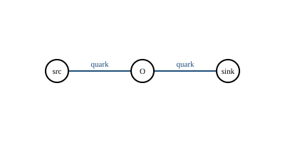
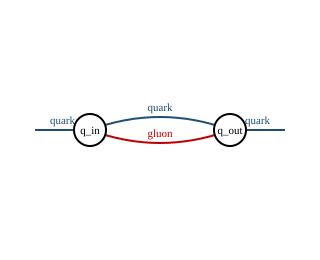
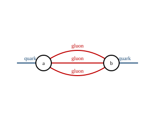

# 费曼图

`myqcd.feynman` 用顶点与边存储费曼图；`myqcd.diagram_export` 导出
TikZ-Feynman、Graphviz DOT 与 SVG。导出器把树图放在水平链上，把纯环图放在
圆周上，把平行边画成分离的二次曲线。

## 两点链图



$V = 3$，$E_{\mathrm{int}} = 2$，$C = 1$，圈数
$L = E_{\mathrm{int}} - V + C = 0$。

## 三胶子三角图


$V = 3$，$E_{\mathrm{int}} = 3$，$C = 1$，圈数
$L = E_{\mathrm{int}} - V + C = 1$。

## 夸克自能（单圈）



$V = 2$，$E_{\mathrm{int}} = 2$（一条夸克线和一条胶子线），$C = 1$，圈数
$L = E_{\mathrm{int}} - V + C = 1$。两条外部夸克腿画成短桩，不计入
$E_{\mathrm{int}}$。

## Sunset（两圈）



$V = 2$，$E_{\mathrm{int}} = 3$（三条内部胶子线），$C = 1$，圈数
$L = E_{\mathrm{int}} - V + C = 2$。

## Wick 配对图


$V = 2$，$E_{\mathrm{int}} = 1$，$C = 1$，圈数
$L = E_{\mathrm{int}} - V + C = 0$。

## 圈数对照

| 图 | $V$ | $E_{\mathrm{int}}$ | $C$ | $L$ | 标准 |
|---|---|---|---|---|---|
| 两点链图 | 3 | 2 | 1 | 0 | 树图 |
| 三胶子三角图 | 3 | 3 | 1 | 1 | 单圈 |
| 夸克自能 | 2 | 2 | 1 | 1 | 单圈 |
| Sunset | 2 | 3 | 1 | 2 | 两圈 |
| Wick 配对图 | 2 | 1 | 1 | 0 | 树图 |

外部腿边（端点为 $-1$）不计入 $E_{\mathrm{int}}$；因此“两顶点、一条内部边
加一条外部腿边”的图仍然满足 $L = 0$。

## QCD 规则清单

| 顶点 | 粒子 | 颜色因子 | Lorentz 因子 | 耦合幂次 |
|---|---|---|---|---|
| quark-antiquark-gluon | $q,\bar q,g$ | $T^a_{ij}$ | $\gamma_\mu$ | $g$ |
| three-gluon | $g,g,g$ | $f^{abc}$ | $(k_1-k_2)_\rho\delta_{\mu\nu}+\cdots$ | $g$ |
| four-gluon | $g,g,g,g$ | $f^{abe}f^{cde}$ | $\delta_{\mu\nu}\delta_{\rho\sigma}$ permutations | $g^2$ |
| ghost-antighost-gluon | $c,\bar c,g$ | $f^{abc}$ | $k_\mu$ | $g$ |

## 导出

```python
from myqcd import diagram_export, feynman

triangle = feynman.Diagram(
    vertices=("a", "b", "c"),
    edges=(
        feynman.Edge(0, 1, "gluon"),
        feynman.Edge(1, 2, "gluon"),
        feynman.Edge(2, 0, "gluon"),
    ),
)
assert triangle.loop_count == 1
print(diagram_export.to_tikz(triangle))
print(diagram_export.to_dot(triangle))
print(diagram_export.to_svg(triangle)[:60])
```

## 命令

```bash
python -m myqcd.operator_audit
```
